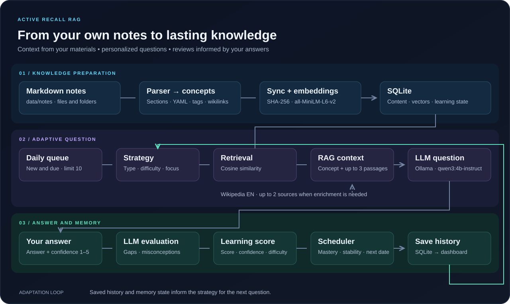
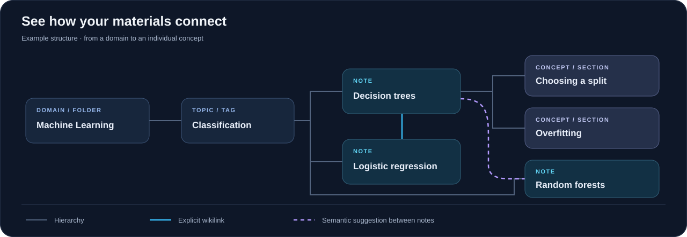

# Active Recall RAG

**Goal: turn your own notes into knowledge you can recall and apply.**

Active Recall RAG generates questions from your notes, evaluates your answers, and schedules future reviews. It combines **active recall**, **RAG**, and **spaced repetition**, adapting each session to your previous mistakes and current memory state.

> **Your notes → question → answer from memory → feedback → next review.**

Python · FastAPI · SQLite · Sentence Transformers · Ollama · Next.js · React Flow

[Pipeline](#current-pipeline) · [Knowledge graph](#knowledge-graph) · [Setup](#local-setup) · [Code](#code-map)

## What you get

- **Questions from your own materials** — context comes from Markdown notes, supplemented by Wikipedia when needed.
- **Personalized reviews** — question type and difficulty depend on mastery, memory, and previous answers.
- **Actionable feedback** — correctness scores, missing points, misconceptions, and a reference answer.
- **Progress tracking** — a dashboard, daily review queue, note browser, and interactive knowledge graph.

## Current pipeline



**1. Prepare the knowledge.** The parser reads Markdown, YAML frontmatter, tags, and wikilinks. Sections with `##`–`######` headings become concepts. Synchronization detects changes using SHA-256; new and updated content receives `all-MiniLM-L6-v2` embeddings stored in SQLite.

**2. Prepare the question.** The daily queue selects up to 10 new or due concepts. The review strategy considers memory state and recent answers. RAG adds up to three similar passages alongside the target concept, and Ollama generates a question and reference answer in a format validated by Pydantic.

**3. Close the loop.** You answer and report your confidence on a 1–5 scale. The model evaluates your answer against the source context. The scheduler combines correctness, difficulty, and confidence, updates your learning state, and sets the next review date. Review history informs future questions.

### How does adaptation work?

**Misconceptions** take priority, followed by **missing points** and **low recall probability**. Otherwise, increasing mastery shifts questions from recall (`free_recall`), through practical use (`application`), to comparing concepts (`comparison`).

- **Mastery** — how well you understand a concept.
- **Retrievability** — the estimated probability of recalling it now; decreases over time.
- **Stability** — memory stability in days, used to schedule the next review.

The project uses a custom heuristic scheduler with an exponential forgetting curve.

### Where does the context come from?

**Your notes** are the primary source. Retrieval compares the query embedding with concept embeddings using cosine similarity. For short notes, weak supporting context, or difficult questions, the code provides for enrichment with up to two English Wikipedia sources. Source provenance is stored with the question attempt and review history.

## Knowledge graph



The graph maps **folders → tag-based topics → notes → concepts**. It combines hierarchy, explicit wikilinks, and semantic similarity suggestions. Suggestions are computed on demand, using a `0.72` threshold and a limit of three neighbors per note.

In the interface, you can expand concepts, open note details, and hide suggestions. Unresolved wikilinks appear as knowledge gaps to fill. The illustration above shows an example structure rather than a snapshot of user data.

## Local setup

You need **Python 3.11+**, **Node.js with npm**, and a running **Ollama** instance. The commands below use PowerShell; run the backend from the repository root.

### 1. Backend and model

```powershell
python -m venv .venv
.\.venv\Scripts\python.exe -m pip install fastapi "uvicorn[standard]" sentence-transformers numpy ollama pydantic requests pyyaml

ollama pull qwen3:4b-instruct
.\.venv\Scripts\python.exe -m uvicorn api.main:app --reload
```

Ollama must run in the background; if it is not running, execute `ollama serve` in a separate terminal. Loading the embedding model for the first time may require downloading its files.

### 2. Add and sync notes

Create `data/notes` and add `.md` files, optionally organized in subfolders. Example: `data/notes/Machine Learning/Trees.md`:

```markdown
---
subject: Machine Learning
tags: [models, classification]
---
# Decision trees

## Choosing a split
A tree chooses a split that reduces group impurity,
using criteria such as Gini impurity or information gain.

## Related concepts
Compare with [[Logistic regression]].
```

In a second terminal, after the API starts:

```powershell
Invoke-RestMethod -Method Post -Uri http://localhost:8000/notes/sync
```

Sync again after changing your notes. Starting the API initializes the database and generates missing embeddings; the `/notes/sync` endpoint imports files. Notes and the `data/learning.db` database stay local and are ignored by Git.

### 3. Frontend

```powershell
cd frontend
npm ci
npm run dev
```

Open the [app](http://localhost:3000) or the [API documentation](http://localhost:8000/docs). The frontend connects to `http://localhost:8000` by default; set `NEXT_PUBLIC_API_URL` in `frontend/.env.local` to use a different address.

**Terminal alternative.** From the repository root, run `.\.venv\Scripts\python.exe main.py` to import notes and start daily reviews or practice a chosen topic.

## Code map

```text
api/                    API: questions, answers, sync, statistics
frontend/app/           Dashboard, review session, note browser, knowledge graph
src/
  ingestion.py          Markdown, sections, YAML, tags, wikilinks
  database.py           SQLite, synchronization, learning history
  embeddings.py         Concept vectors
  retrieval.py          Semantic search
  review_engine.py      Adaptive question assembly for the API
  adaptive.py           Question type, difficulty, and focus selection
  context.py            Combining passages and external sources
  external_knowledge.py Context enrichment from Wikipedia
  generator.py          Question generation through Ollama
  evaluator.py          Answer evaluation and feedback
  scheduler.py          Memory state and next review date
  knowledge_graph.py    Hierarchy and explicit relationships
  semantic_graph.py     Suggested relationships between notes
tests/                  Tests and diagnostic scripts
main.py                 Terminal interface
```

## Tests and current limitations

Run parser, synchronization, and graph tests without Ollama:

```powershell
.\.venv\Scripts\python.exe -m unittest tests.test_ingestion tests.test_knowledge_graph
```

`tests/test_evaluator.py` is a script that calls the actual model, so it requires a running Ollama instance.

The project is a **local prototype**. `requirements.txt` is currently empty, so dependencies are installed explicitly above. Models are configured in code: `src/embeddings.py`, `src/generator.py`, and `src/evaluator.py`.

**Known API limitation:** in `src/review_engine.py`, `external_sources` is not initialized when Wikipedia is not needed. This branch can interrupt question generation with an `UnboundLocalError`.
